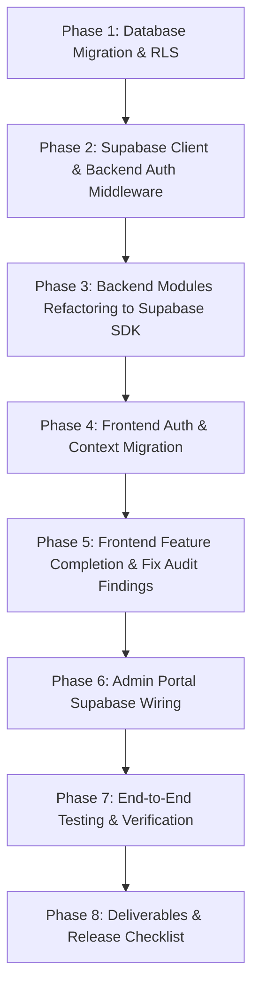

# CREATORS HQ — SUPABASE ARCHITECTURE MIGRATION PLAN

**Document Version:** 1.0.0  
**Target Release:** CreatorsHQ V1 Beta  
**Author:** Lead Software Architect & Senior Full-Stack Engineer  
**Date:** October 14, 2026  

---

## 1. Executive Summary & Objective

The primary objective is to systematically migrate CreatorsHQ from a fragmented MongoDB / custom JWT / local storage mock architecture to a unified, production-grade **Supabase** backend platform using:
- **Supabase Auth** (email/password, OAuth with Google & LinkedIn, session tokens, password recovery).
- **Supabase PostgreSQL** as the primary authoritative data store for all business entities.
- **Supabase Row Level Security (RLS)** to enforce granular database-level access control.
- **Supabase Storage** for creator avatars, brand logos, campaign assets, and verification screenshots.
- **Refined Express Services** dedicated to privileged server-side operations (OpenAI AI Studio proxy, rate-limiting, and webhook listeners) with Supabase JWT authentication middleware.

---

## 2. Source-to-Target Data & Entity Mapping

| MongoDB / Mongoose Model | Supabase PostgreSQL Table | Relationship / Foreign Key | RLS & Ownership Model |
| :--- | :--- | :--- | :--- |
| `User` (`modules/auth/models.js`) | `profiles` | `id UUID REFERENCES auth.users(id) ON DELETE CASCADE` | User can read all public profiles, update own profile only. Admin can read/update all. |
| `CreatorProfile` (`modules/creators/models.js`) | `creator_profiles` | `user_id UUID REFERENCES auth.users(id) ON DELETE CASCADE UNIQUE` | Publicly readable for active creators; updatable only by owning creator. |
| `BrandProfile` (`modules/creators/brandModel.js`) | `brand_profiles` | `user_id UUID REFERENCES auth.users(id) ON DELETE CASCADE UNIQUE` | Publicly readable company info; updatable only by owning brand. |
| `Campaign` (`modules/market/models.js`) | `campaigns` | `brand_id UUID REFERENCES auth.users(id) ON DELETE CASCADE` | Public read for open campaigns; full mutation only by owning brand or admin. |
| `CampaignApplication` (`modules/market/applicationModel.js`) | `campaign_applications` | `campaign_id UUID REFERENCES campaigns(id), creator_id UUID REFERENCES auth.users(id)` | Creator sees own applications; brand sees applicants for own campaigns; unique constraint on `(campaign_id, creator_id)`. |
| `Collaboration` (`modules/collaborations/models.js`) | `collaborations` | `sender_id UUID REFERENCES auth.users(id), receiver_id UUID REFERENCES auth.users(id)` | Readable and updatable strictly by participants (`sender_id = auth.uid() OR receiver_id = auth.uid()`) or admin. |
| `Lead` (`modules/leads/models.js`) | `leads` | `user_id UUID REFERENCES auth.users(id) ON DELETE CASCADE` | Isolated strictly to owning account (`user_id = auth.uid()`). |
| `Notification` (`modules/notifications/models.js`) | `notifications` | `user_id UUID REFERENCES auth.users(id) ON DELETE CASCADE` | Isolated strictly to recipient (`user_id = auth.uid()`). |
| `AiGeneration` (`modules/ai/models.js`) | `ai_generations` | `user_id UUID REFERENCES auth.users(id) ON DELETE CASCADE` | Isolated strictly to owner (`user_id = auth.uid()`). |
| `Transaction` (`modules/billing/models.js`) | `transactions` | `sender_id UUID, recipient_id UUID REFERENCES auth.users(id)` | Visible to participants or admin. |
| *New Entity* | `feedback` | `user_id UUID REFERENCES auth.users(id) ON DELETE SET NULL` | Insert by authenticated user; read only by admin. |
| *New Entity* | `audit_logs` | `actor_id UUID REFERENCES auth.users(id) ON DELETE SET NULL` | Insert by system service; read only by admin. |

---

## 3. Architecture Sequence & Implementation Phases

### Phase 1: Database Schema & Migration Scripts
1. Create `supabase/migrations/20261014000000_creatorshq_v1_init.sql` containing all table schemas, constraints, indexes, triggers (`on_auth_user_created`), and comprehensive RLS policies.
2. Create `CREATORSHQ_SUPABASE_SCHEMA.md` documenting table relationships, types, and policies.
3. Build a repeatable Node.js migration script `backend/src/scripts/migrate-mongo-to-supabase.js` to transfer existing MongoDB documents into Supabase PostgreSQL idempotently.

### Phase 2: Supabase Client & Backend Auth
1. Initialize centralized Supabase clients:
   - `backend/src/config/supabase.js` using `SUPABASE_URL` and `SUPABASE_SERVICE_ROLE_KEY` (server-side only).
   - `frontend/src/lib/supabase.ts` using `VITE_SUPABASE_URL` and `VITE_SUPABASE_ANON_KEY` (browser-safe).
   - `admin/src/lib/supabase.js` using `VITE_SUPABASE_URL` and `VITE_SUPABASE_ANON_KEY`.
2. Replace `backend/src/middleware/auth.js` to verify Supabase JWT tokens via `supabase.auth.getUser(token)`.
3. Eliminate hardcoded admin token (`userId === 'admin'`). Admin authorization validates `role = 'admin'` from verified profile.

### Phase 3: Backend REST Services Refactoring
1. Update route controllers to query Supabase PostgreSQL:
   - Creators & Brands (`creators/controllers.js`, `creators/brandController.js`).
   - Campaigns & Applications (`market/routes.js`).
   - Collaborations (`collaborations/controllers.js` with BOLA IDOR fix).
   - Leads CRM (`leads/routes.js`).
   - Notifications (`notifications/controllers.js` - wire `createNotification` to trigger on actual workflow events).
   - AI Studio (`ai/controllers.js` - fix `'ideas'` vs `'idea'` enum mismatch).
   - Verification guard (`verification/routes.js` - fix privilege escalation by requiring `authorize('admin')`).
   - Admin routes (`admin/controllers.js`).
   - User feedback endpoint (`feedback/routes.js`).

### Phase 4: Frontend Authentication & Context Migration
1. Rewrite `frontend/src/context/AuthContext.tsx` to use `supabase.auth`:
   - `signUp`, `signInWithPassword`, `signOut`, `resetPasswordForEmail`, `updateUser`.
   - Google & LinkedIn OAuth via `supabase.auth.signInWithOAuth`.
   - Session listener via `supabase.auth.onAuthStateChange`.
2. Update Auth pages:
   - `Login.tsx`, `Signup.tsx`, `ForgotPassword.tsx`, `ResetPassword.tsx`, `DashboardRedirect.tsx`.
3. Implement Onboarding Flow:
   - Creator and Brand guided onboarding step saving directly to Supabase profile and updating `is_onboarded = true`.

### Phase 5: Frontend Feature Completion & Fixes
1. `Dashboard.tsx`: Bind real Supabase aggregated metrics (`growth_score`, `followers`, `engagement_rate`, `earnings`).
2. `Creators.tsx`: Fix "Send Proposal" to create real collaboration records; fix search pagination; sanitize email.
3. `CRM.tsx`: Connect search, filtering, edit, and delete actions directly to backend/Supabase.
4. `Notifications.tsx`: Connect to live backend `/api/notifications` instead of `localStorage` dummy activity.
5. `Billing.tsx`: Replace unsafe raw card form with safe V1 Beta billing modal (Beta Free Tier / Coming Soon).
6. Legal pages: Add `PrivacyPolicy.tsx` and `TermsOfService.tsx`, update router and footer.
7. SEO & Metatags: Add title, description, OpenGraph, and Twitter tags in `frontend/index.html`.

### Phase 6: Admin Portal Supabase Wiring
1. Refactor `admin/src/api.js` and `admin/src/context/AuthContext.jsx` to use Supabase Auth and authenticated admin endpoints.
2. Remove hardcoded `mockGrowth` and synthetic metrics from `DashboardPage.jsx` and `AnalyticsPage.jsx`.

### Phase 7: Verification & Testing
1. Run baseline build and lint checks across `frontend`, `backend`, and `admin`.
2. Execute automated Supabase integration test suite.
3. Run end-to-end endpoint verification.

---

## 4. Security & Compliance Principles
- **Service-Role Key Isolation**: Stored exclusively on the Node.js backend; never referenced in `frontend/` or `admin/`.
- **Row Level Security (RLS)**: Enforced on all tables with explicit SELECT, INSERT, UPDATE, DELETE policies.
- **Role Verification**: Admin privileges verified server-side against `profiles.role = 'admin'` tied to Supabase `auth.uid()`.
- **Input Sanitization & Projection**: Ensure sensitive creator emails and passwords are never returned in public discovery endpoints.
