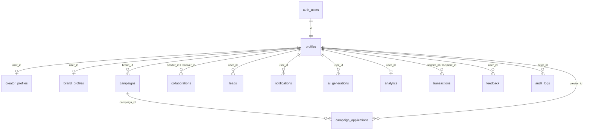

# CREATORS HQ — SUPABASE DATABASE SCHEMA SPECIFICATION

**Document Version:** 1.0.0  
**Target Release:** CreatorsHQ V1 Beta  
**Database:** PostgreSQL 15+ (Supabase)  
**Migration File:** `supabase/migrations/20261014000000_creatorshq_v1_init.sql`  
**Date:** October 14, 2026  

---

## 1. Schema Architecture & Design Principles

CreatorsHQ uses **Supabase PostgreSQL** as its primary authoritative data store. The relational design guarantees data integrity, foreign key cascading, strong type validation, automated audit timestamps, and database-enforced Row Level Security (RLS).

### Architectural Highlights:
1. **Identity Isolation**: User authentication and credential management are handled directly in `auth.users`. Application profile metadata is stored in `public.profiles` keyed 1-to-1 with `auth.users(id)` via `ON DELETE CASCADE`.
2. **Role & Verification Protection**: Database triggers (`protect_profile_privileged_fields`) prohibit non-admin users from altering their own `role`, `is_verified`, `is_blocked`, or `is_suspended` flags, completely eliminating client-side privilege escalation.
3. **Automated User Lifecycle**: A PostgreSQL trigger `on_auth_user_created` intercepts newly registered identities in `auth.users`, automatically creating corresponding entries in `profiles`, and `creator_profiles` or `brand_profiles`.
4. **Row Level Security (RLS)**: Active across 100% of tables. Access to sensitive records (collaborations, campaign applications, CRM leads, private notifications, and AI generation histories) is strictly restricted to participants or verified administrators.

---

## 2. Table Specifications & Relationships

### Table 1: `public.profiles`
| Column | Type | Constraints | Description |
| :--- | :--- | :--- | :--- |
| `id` | `UUID` | `PRIMARY KEY, REFERENCES auth.users(id) ON DELETE CASCADE` | Auth user identifier |
| `name` | `TEXT` | `NOT NULL DEFAULT ''` | Display name / full name |
| `email` | `TEXT` | `NOT NULL` | User email address |
| `role` | `TEXT` | `NOT NULL DEFAULT 'creator' CHECK (role IN ('creator', 'brand', 'admin'))` | Account type |
| `is_verified` | `BOOLEAN` | `NOT NULL DEFAULT false` | Verified badge status |
| `is_blocked` | `BOOLEAN` | `NOT NULL DEFAULT false` | Account blocked by admin |
| `is_suspended` | `BOOLEAN` | `NOT NULL DEFAULT false` | Account suspended by admin |
| `social_handle` | `TEXT` | `DEFAULT ''` | Primary social handle |
| `avatar` | `TEXT` | `DEFAULT ''` | Profile image URL |
| `plan` | `TEXT` | `NOT NULL DEFAULT 'free' CHECK (plan IN ('free', 'pro'))` | Subscription tier |
| `is_onboarded` | `BOOLEAN` | `NOT NULL DEFAULT false` | Onboarding wizard completed |
| `verification_status` | `TEXT` | `NOT NULL DEFAULT 'not_submitted' CHECK (...)` | Verification workflow status |
| `verification_screenshot`| `TEXT` | `DEFAULT ''` | Storage path to verification proof |
| `verification_code` | `TEXT` | `DEFAULT ''` | One-time code for social verification |
| `integrations` | `JSONB` | `NOT NULL DEFAULT '{}'` | Third-party service toggles |
| `socials` | `JSONB` | `NOT NULL DEFAULT '...'` | Social handles, verification timestamps |
| `created_at` | `TIMESTAMPTZ`| `NOT NULL DEFAULT now()` | Row creation timestamp |
| `updated_at` | `TIMESTAMPTZ`| `NOT NULL DEFAULT now()` | Row update timestamp |

### Table 2: `public.creator_profiles`
| Column | Type | Constraints | Description |
| :--- | :--- | :--- | :--- |
| `id` | `UUID` | `PRIMARY KEY DEFAULT gen_random_uuid()` | Record identifier |
| `user_id` | `UUID` | `NOT NULL REFERENCES auth.users(id) ON DELETE CASCADE UNIQUE` | Creator user link |
| `username` | `TEXT` | `DEFAULT ''` | Unique creator username |
| `avatar` | `TEXT` | `DEFAULT ''` | Creator avatar |
| `cover_image` | `TEXT` | `DEFAULT ''` | Profile banner URL |
| `bio` | `TEXT` | `DEFAULT ''` | Creator bio |
| `niche` | `TEXT` | `DEFAULT ''` | Primary content niche |
| `sub_categories`| `TEXT[]` | `DEFAULT '{}'` | Niche sub-categories |
| `languages` | `TEXT[]` | `DEFAULT '{}'` | Spoken languages |
| `content_types`| `TEXT[]` | `DEFAULT '{}'` | Formats (Reels, Shorts, Blog) |
| `location` | `TEXT` | `DEFAULT ''` | Geographical location |
| `website` | `TEXT` | `DEFAULT ''` | External link |
| `goals` | `TEXT` | `DEFAULT ''` | Creator growth goals |
| `collaboration_preferences` | `TEXT` | `DEFAULT ''` | Sponsorship preferences |
| `preferred_brand_categories` | `TEXT[]` | `DEFAULT '{}'` | Target industries |
| `portfolio` | `JSONB` | `NOT NULL DEFAULT '[]'` | Array of portfolio items |
| `followers` | `INTEGER` | `NOT NULL DEFAULT 0` | Total follower count |
| `engagement_rate` | `NUMERIC(5,2)` | `NOT NULL DEFAULT 0.00` | Percentage engagement rate |
| `growth_score` | `INTEGER` | `NOT NULL DEFAULT 0` | Algorithmic growth rating (0-100) |
| `social_links` | `JSONB` | `NOT NULL DEFAULT '...'` | Links to Instagram, YouTube, Twitter, etc. |
| `created_at` | `TIMESTAMPTZ`| `NOT NULL DEFAULT now()` | Creation timestamp |
| `updated_at` | `TIMESTAMPTZ`| `NOT NULL DEFAULT now()` | Modification timestamp |

### Table 3: `public.brand_profiles`
| Column | Type | Constraints | Description |
| :--- | :--- | :--- | :--- |
| `id` | `UUID` | `PRIMARY KEY DEFAULT gen_random_uuid()` | Record identifier |
| `user_id` | `UUID` | `NOT NULL REFERENCES auth.users(id) ON DELETE CASCADE UNIQUE` | Brand user link |
| `company_name` | `TEXT` | `DEFAULT ''` | Registered company name |
| `logo` | `TEXT` | `DEFAULT ''` | Brand logo URL |
| `website` | `TEXT` | `DEFAULT ''` | Corporate website |
| `industry` | `TEXT` | `DEFAULT ''` | Brand market sector |
| `location` | `TEXT` | `DEFAULT ''` | Headquarter location |
| `description` | `TEXT` | `DEFAULT ''` | Corporate overview |
| `objectives` | `TEXT` | `DEFAULT ''` | Partnership goals |
| `budget` | `TEXT` | `DEFAULT ''` | Typical campaign budget |
| `created_at` | `TIMESTAMPTZ`| `NOT NULL DEFAULT now()` | Creation timestamp |
| `updated_at` | `TIMESTAMPTZ`| `NOT NULL DEFAULT now()` | Modification timestamp |

### Table 4: `public.campaigns`
| Column | Type | Constraints | Description |
| :--- | :--- | :--- | :--- |
| `id` | `UUID` | `PRIMARY KEY DEFAULT gen_random_uuid()` | Campaign identifier |
| `brand_id` | `UUID` | `NOT NULL REFERENCES auth.users(id) ON DELETE CASCADE` | Publishing brand |
| `title` | `TEXT` | `NOT NULL` | Campaign title |
| `description` | `TEXT` | `NOT NULL` | Brief and expectations |
| `budget` | `TEXT` | `NOT NULL` | Compensation terms |
| `niche` | `TEXT` | `DEFAULT ''` | Target creator category |
| `deliverables` | `TEXT` | `DEFAULT ''` | Expected content outputs |
| `requirements` | `TEXT` | `DEFAULT ''` | Eligibility criteria |
| `deadline` | `TIMESTAMPTZ`| `NULL` | Submission cutoff |
| `image` | `TEXT` | `DEFAULT ''` | Campaign banner asset |
| `status` | `TEXT` | `NOT NULL DEFAULT 'open' CHECK (...)` | `'draft', 'open', 'paused', 'closed'` |
| `created_at` | `TIMESTAMPTZ`| `NOT NULL DEFAULT now()` | Creation timestamp |
| `updated_at` | `TIMESTAMPTZ`| `NOT NULL DEFAULT now()` | Modification timestamp |

### Table 5: `public.campaign_applications`
| Column | Type | Constraints | Description |
| :--- | :--- | :--- | :--- |
| `id` | `UUID` | `PRIMARY KEY DEFAULT gen_random_uuid()` | Application identifier |
| `campaign_id` | `UUID` | `NOT NULL REFERENCES campaigns(id) ON DELETE CASCADE` | Associated campaign |
| `creator_id` | `UUID` | `NOT NULL REFERENCES auth.users(id) ON DELETE CASCADE` | Applicant creator |
| `message` | `TEXT` | `DEFAULT ''` | Pitch proposal message |
| `status` | `TEXT` | `NOT NULL DEFAULT 'pending' CHECK (...)` | `'pending', 'approved', 'rejected'` |
| `created_at` | `TIMESTAMPTZ`| `NOT NULL DEFAULT now()` | Timestamp |
| `updated_at` | `TIMESTAMPTZ`| `NOT NULL DEFAULT now()` | Timestamp |
| *Constraint* | `UNIQUE` | `(campaign_id, creator_id)` | Prevents duplicate applications |

### Table 6: `public.collaborations`
| Column | Type | Constraints | Description |
| :--- | :--- | :--- | :--- |
| `id` | `UUID` | `PRIMARY KEY DEFAULT gen_random_uuid()` | Record identifier |
| `sender_id` | `UUID` | `NOT NULL REFERENCES auth.users(id) ON DELETE CASCADE` | Proposing party |
| `receiver_id` | `UUID` | `NOT NULL REFERENCES auth.users(id) ON DELETE CASCADE` | Invited party |
| `message` | `TEXT` | `DEFAULT ''` | Proposal details |
| `status` | `TEXT` | `NOT NULL DEFAULT 'pending' CHECK (...)` | `'pending', 'accepted', 'rejected', 'completed'` |
| `created_at` | `TIMESTAMPTZ`| `NOT NULL DEFAULT now()` | Creation timestamp |
| `updated_at` | `TIMESTAMPTZ`| `NOT NULL DEFAULT now()` | Modification timestamp |

### Table 7: `public.leads` (CRM)
| Column | Type | Constraints | Description |
| :--- | :--- | :--- | :--- |
| `id` | `UUID` | `PRIMARY KEY DEFAULT gen_random_uuid()` | Lead identifier |
| `user_id` | `UUID` | `NOT NULL REFERENCES auth.users(id) ON DELETE CASCADE` | Owning account |
| `name` | `TEXT` | `NOT NULL` | Contact name |
| `email` | `TEXT` | `DEFAULT ''` | Contact email |
| `phone` | `TEXT` | `DEFAULT ''` | Contact phone |
| `company` | `TEXT` | `DEFAULT ''` | Associated organization |
| `status` | `TEXT` | `NOT NULL DEFAULT 'Warm' CHECK (...)` | `'Hot', 'Warm', 'Cold'` |
| `value` | `TEXT` | `DEFAULT ''` | Estimated deal value |
| `notes` | `TEXT` | `DEFAULT ''` | Private relationship notes |
| `source` | `TEXT` | `DEFAULT 'manual'` | Acquisition channel |
| `created_at` | `TIMESTAMPTZ`| `NOT NULL DEFAULT now()` | Creation timestamp |
| `updated_at` | `TIMESTAMPTZ`| `NOT NULL DEFAULT now()` | Modification timestamp |

### Table 8: `public.notifications`
| Column | Type | Constraints | Description |
| :--- | :--- | :--- | :--- |
| `id` | `UUID` | `PRIMARY KEY DEFAULT gen_random_uuid()` | Notification identifier |
| `user_id` | `UUID` | `NOT NULL REFERENCES auth.users(id) ON DELETE CASCADE` | Target recipient |
| `title` | `TEXT` | `NOT NULL` | Alert title |
| `message` | `TEXT` | `NOT NULL` | Notification body |
| `type` | `TEXT` | `NOT NULL DEFAULT 'system' CHECK (...)` | `'system', 'collaboration', 'campaign', 'application', 'lead', 'ai'` |
| `read` | `BOOLEAN` | `NOT NULL DEFAULT false` | Read status |
| `link` | `TEXT` | `DEFAULT ''` | In-app navigation URL |
| `created_at` | `TIMESTAMPTZ`| `NOT NULL DEFAULT now()` | Creation timestamp |

### Table 9: `public.ai_generations`
| Column | Type | Constraints | Description |
| :--- | :--- | :--- | :--- |
| `id` | `UUID` | `PRIMARY KEY DEFAULT gen_random_uuid()` | Generation ID |
| `user_id` | `UUID` | `NOT NULL REFERENCES auth.users(id) ON DELETE CASCADE` | Creator user |
| `type` | `TEXT` | `NOT NULL DEFAULT 'idea' CHECK (...)` | `'caption', 'bio', 'pitch', 'hashtags', 'script', 'email', 'idea', 'ideas', 'default'` |
| `prompt` | `TEXT` | `NOT NULL` | User input prompt |
| `output` | `TEXT` | `NOT NULL` | AI synthesized copy |
| `tokens_used` | `INTEGER` | `NOT NULL DEFAULT 0` | Token usage |
| `model` | `TEXT` | `NOT NULL DEFAULT 'gpt-4o-mini'` | Engine identifier |
| `created_at` | `TIMESTAMPTZ`| `NOT NULL DEFAULT now()` | Creation timestamp |

### Table 10: `public.analytics`
| Column | Type | Constraints | Description |
| :--- | :--- | :--- | :--- |
| `id` | `UUID` | `PRIMARY KEY DEFAULT gen_random_uuid()` | Record ID |
| `user_id` | `UUID` | `NOT NULL REFERENCES auth.users(id) ON DELETE CASCADE UNIQUE` | Creator user |
| `followers` | `INTEGER` | `NOT NULL DEFAULT 0` | Follower count |
| `engagement` | `NUMERIC(5,2)` | `NOT NULL DEFAULT 0.00` | Engagement % |
| `earnings` | `NUMERIC(10,2)`| `NOT NULL DEFAULT 0.00` | Recorded earnings |
| `growth_score` | `INTEGER` | `NOT NULL DEFAULT 0` | Aggregate score |
| `historical_data`| `JSONB` | `NOT NULL DEFAULT '[]'` | Historical timeline array |
| `instagram_data` | `JSONB` | `NOT NULL DEFAULT '...'` | Platform metadata |
| `last_updated` | `TIMESTAMPTZ`| `NOT NULL DEFAULT now()` | Last sync |
| `created_at` | `TIMESTAMPTZ`| `NOT NULL DEFAULT now()` | Creation timestamp |
| `updated_at` | `TIMESTAMPTZ`| `NOT NULL DEFAULT now()` | Modification timestamp |

### Table 11: `public.transactions` (Billing Activity Ledger)
| Column | Type | Constraints | Description |
| :--- | :--- | :--- | :--- |
| `id` | `UUID` | `PRIMARY KEY DEFAULT gen_random_uuid()` | Transaction ID |
| `sender_id` | `UUID` | `NOT NULL REFERENCES auth.users(id) ON DELETE CASCADE` | Paying user |
| `recipient_id`| `UUID` | `NOT NULL REFERENCES auth.users(id) ON DELETE CASCADE` | Receiving party or platform |
| `amount` | `NUMERIC(10,2)`| `NOT NULL` | Payment amount |
| `currency` | `TEXT` | `NOT NULL DEFAULT 'INR'` | Currency code |
| `status` | `TEXT` | `NOT NULL DEFAULT 'paid' CHECK (...)` | `'pending', 'paid', 'failed'` |
| `created_at` | `TIMESTAMPTZ`| `NOT NULL DEFAULT now()` | Record timestamp |

### Table 12: `public.feedback`
| Column | Type | Constraints | Description |
| :--- | :--- | :--- | :--- |
| `id` | `UUID` | `PRIMARY KEY DEFAULT gen_random_uuid()` | Feedback ID |
| `user_id` | `UUID` | `REFERENCES auth.users(id) ON DELETE SET NULL` | Submitting user |
| `user_email` | `TEXT` | `DEFAULT ''` | Submitter email |
| `category` | `TEXT` | `NOT NULL DEFAULT 'general' CHECK (...)` | `'bug', 'feature', 'general', 'support'` |
| `subject` | `TEXT` | `NOT NULL` | Subject line |
| `message` | `TEXT` | `NOT NULL` | Details / feedback body |
| `status` | `TEXT` | `NOT NULL DEFAULT 'open' CHECK (...)` | `'open', 'in_review', 'resolved', 'closed'` |
| `created_at` | `TIMESTAMPTZ`| `NOT NULL DEFAULT now()` | Submission timestamp |

### Table 13: `public.audit_logs`
| Column | Type | Constraints | Description |
| :--- | :--- | :--- | :--- |
| `id` | `UUID` | `PRIMARY KEY DEFAULT gen_random_uuid()` | Audit log ID |
| `actor_id` | `UUID` | `REFERENCES auth.users(id) ON DELETE SET NULL` | Performing user |
| `action` | `TEXT` | `NOT NULL` | Event key (e.g. `USER_VERIFIED`) |
| `entity_type` | `TEXT` | `NOT NULL` | Target model name |
| `entity_id` | `TEXT` | `NULL` | Target record UUID |
| `details` | `JSONB` | `DEFAULT '{}'` | Metadata diff |
| `ip_address` | `TEXT` | `DEFAULT ''` | Origin IP |
| `created_at` | `TIMESTAMPTZ`| `NOT NULL DEFAULT now()` | Event timestamp |

---

## 3. Storage Buckets & Policies

| Bucket Name | Access Level | Permitted File Types | Max File Size | Target Usage |
| :--- | :--- | :--- | :--- | :--- |
| `avatars` | Public Read | `image/jpeg, image/png, image/webp` | 5 MB | User avatars and logos |
| `campaign_assets` | Public Read | `image/jpeg, image/png, image/webp, application/pdf` | 15 MB | Campaign briefs and media |
| `verification_docs` | Private (Owner + Admin) | `image/jpeg, image/png, application/pdf` | 10 MB | Social verification screenshots |
